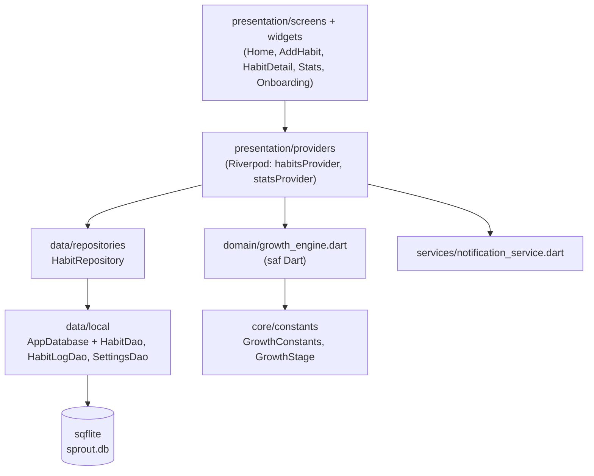

# Sprout — Mimari

## Katmanlar

- **domain** hiçbir Flutter, sqflite veya Riverpod bağımlılığı içermez; yalnızca
  `HabitSchedule` + tamamlanan günler + bugünün tarihi alır.
- **Puan her seferinde log'lardan yeniden oynatılarak (replay) hesaplanır.**
  `habits.growth_score` yalnızca önbellektir. Böylece geçmiş bir günü düzeltmek,
  uygulamayı günlerce açmamak veya saat dilimi/yaz saati değişimi tutarsızlık
  yaratmaz.
- Uygulama ön plana döndüğünde (`AppLifecycleListener`) ya da açıkken gece
  yarısı geçtiğinde (`Timer`) puanlar yeniden hesaplanır; solma bu sayede
  "arka planda" da işler.

## Büyüme algoritması

Bir **dönem** = günlük alışkanlıkta bir gün, özel günlerde seçili bir hafta günü,
haftalıkta 7 günlük blok (blokta `times_per_week` farklı gün tamamlanınca
dönem tamamlanır). Her dönem sırayla işlenir:

| Durum | Etki |
|---|---|
| Tamamlandı | `taban × min(1 + (seri−1)·0.1, 2.0)` puan eklenir, seri +1 |
| Açık dönem (bugün / bu hafta), henüz yapılmadı | Etkisiz |
| Tatil (`habit_pauses`) aralığında, yapılmadı | Etkisiz; seri bozulmaz |
| Kaçırıldı | Seri sıfırlanır; ilk kaçırma tolere edilir, sonrası `5, 7, 9 … ≤15` ceza |
| Art arda 3 gün (haftalıkta 2 hafta) kaçırıldı | Bitki **solmuş** görünür |

Tüm değerler `lib/core/constants/growth_constants.dart` içindedir.

## Paketler ve gerekçeleri

| Paket | Neden |
|---|---|
| `flutter_riverpod` | Test edilebilir, `BuildContext`'ten bağımsız durum yönetimi; testlerde saat/DB/bildirim override edilebiliyor |
| `sqflite` (+ `path`) | Offline-first, ilişkisel veri (alışkanlık ↔ log, `ON DELETE CASCADE`, `UNIQUE(habit_id, date)`) |
| `intl` | Türkçe tarih/gün adları |
| `flutter_local_notifications` | Backend'siz günlük hatırlatma |
| `timezone`, `flutter_timezone` | `zonedSchedule` için zorunlu; cihazın yerel saat diliminde doğru saatte bildirim |
| `fl_chart` | Haftalık/aylık tamamlanma grafiği |
| `file_picker` | Yedek dosyasını sistem dosya ekranıyla kaydetme/açma; izin gerektirmez (Linux'ta `zenity`/`kdialog` ya da xdg portal kullanır) |
| `flutter_localizations` (SDK) | Saat seçici vb. Material bileşenlerinin Türkçe olması |
| `flutter_launcher_icons` (dev) | İkon üretimi |
| `sqflite_common_ffi` (dev) | Veri katmanı ve uçtan uca testleri masaüstünde bellek içi SQLite ile çalıştırmak |

`lottie` henüz eklenmedi: animasyon dosyaları hazır olana kadar bitkiler
`CustomPainter` ile çiziliyor (bkz. plan, Hafta 3).

## Testler

| Dosya | Kapsam |
|---|---|
| `test/domain/growth_engine_test.dart` | Evre eşikleri, streak, ihmal/ceza, solma, özel gün, haftalık, haftada N kez, tatil, yaz saati |
| `test/data/habit_repository_test.dart` | CRUD, log upsert, cascade silme, tatil, JSON yedek, sıfırlama ve geri alma |
| `test/data/app_database_test.dart` | v1 → son sürüm migration'ında veri korunur |
| `test/services/notification_service_test.dart` | Hatırlatma zamanı: saat, özel gün, tamamlanan günü atlama |
| `test/presentation/stats_provider_test.dart` | İstatistik hesapları (bugün, haftalık, tatil) |
| `test/app_flow_test.dart` | Onboarding, ekle → sula → geri al → yeniden aç, evre kutlaması, solma, tatil, sıklık değişikliği onayı, istatistik, silme |

## Yedekleme

Menüdeki "Yedeği dışa aktar" tüm alışkanlıkları, kayıtları ve tatilleri bir
JSON dosyasına yazar; "Yedeği içe aktar" seçilen dosyayı tek bir transaction
içinde içe aktarır (bozuk veride hiçbir şey değişmez). Dosya konumunu kullanıcı
sistemin kendi dosya ekranında seçer: Android'de Storage Access Framework
(`ACTION_CREATE_DOCUMENT` / `ACTION_OPEN_DOCUMENT`). Bu yüzden uygulama hiçbir
depolama izni (`READ/WRITE_EXTERNAL_STORAGE`, `MANAGE_EXTERNAL_STORAGE`,
`READ_MEDIA_*`) istemez; Google Play'in "Tüm dosyalara erişim" ve fotoğraf/video
izin politikalarına takılmaz. "Uygulamayı
sıfırla" silmeden önce `app_settings.backup_before_reset` anahtarına otomatik
yedek alır; "Sıfırlamayı geri al" bunu geri getirir.
